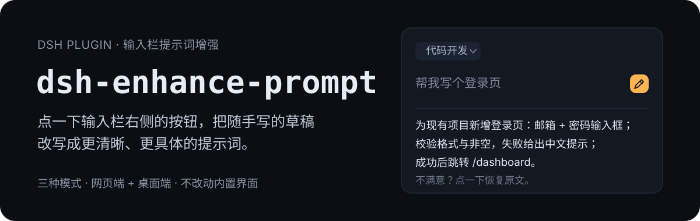
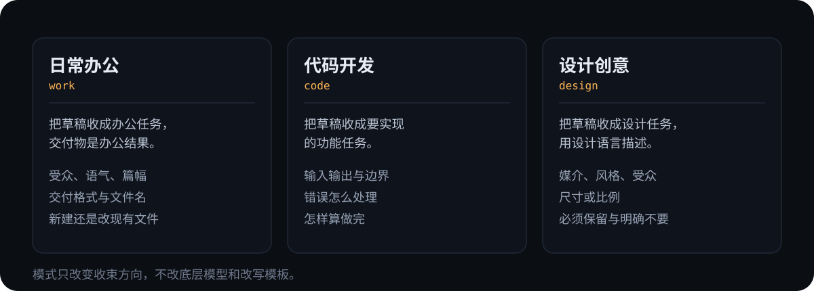

<p align="center">
  
</p>

# dsh-enhance-prompt

DeepSeek Harness 的输入栏插件：把你随手敲的草稿改写成一条更清晰、更具体的提示词。改写结果直接写回输入框，不满意一键还原。

- **原地改写**：不弹窗、不复制粘贴，结果替换输入框里的文字。
- **三种收束模式**：日常办公 / 代码开发 / 设计创意，同一句草稿收的方向不一样。
- **装在桌面版里**：按钮挂在输入栏插槽上，不改动内置界面。
- **出错不毁稿**：30 秒超时、请求失败都不会用半截结果覆盖你的原文。

## 先看效果

<p align="center">
  
</p>

左边 18 个字的草稿，在「代码开发」模式下会被收成写明范围、字段、校验、失败态、跳转和依赖约束的提示词。这是**改写后的提示词**，不是模型对这个需求的回答。

## 安装

只针对 **DeepSeek-Harness 桌面版**。装之前先**完全退出桌面版**，否则 `dsh` 会提示 profile 被应用独占。

```sh
dsh plugin --profile desktop add git+https://github.com/feiwell/dsh-enhance-prompt.git
```

装完重新打开桌面版，输入栏右侧就会出现模式菜单和增强按钮。插件自带 `cordis.patch.yml`，安装时会自动写进 desktop profile，不用手改配置。

也可以让 Agent 代劳：在 DSH 里说一句「装上 https://github.com/feiwell/dsh-enhance-prompt 这个插件」，它会调用插件管理器完成安装。

> 本包尚未发布到 npm，`dsh plugin add dsh-enhance-prompt` 会报 404，请用上面的 git 地址。

## 怎么用

1. 在输入框里写你要做的事，哪怕只有一句话。
2. 点模式菜单选一个模式（默认「日常办公」，选过一次会记住）。
3. 点增强按钮，按钮变成「增强中…」；改写完成后结果直接替换输入框里的文字，按钮变成「恢复原文」。
4. 觉得改得不好，再点一下还原，原文一直在。

几个边界：输入框为空时按钮是灰的；正在发送消息、或模型还在判定时按钮临时禁用；一次改写最多等 30 秒，超时提示「增强超时」而原文不动；提示词上限 48 KB。

## 三种模式

<p align="center">
  
</p>

| 模式 | 把草稿当成 | 会补上 |
| --- | --- | --- |
| 日常办公 `work` | 一件办公任务 | 受众、语气、篇幅、交付物；涉及 Word / PPT / Excel 时写明新建还是改现有文件 |
| 代码开发 `code` | 一个要实现的功能 | 输入输出、边界、错误处理、怎样算做完；不替你选技术栈，也不把实现代码写进提示词 |
| 设计创意 `design` | 一个设计任务 | 媒介、风格、受众、尺寸或比例、必须保留与明确不要的元素 |

模式只改变收束方向，底层模型和改写模板是同一套。

## `/enhance` 命令

```sh
/enhance 帮我写个登录页
/enhance --code 加一个导出 CSV 的按钮
/enhance --design 做一个活动海报
```

命令把结果作为命令结果返回，不会改动输入框里的文字。想在输入栏里原地改写，用按钮。

## 接口

`POST /api/enhance-prompt`

```json
{ "input": "要增强的提示词", "mode": "work" }
```

`mode` 只认 `work`、`code`、`design`，传别的按 `work` 处理。成功返回 `{ "text": "...", "mode": "work" }`；失败返回 `{ "error": "..." }`，状态码 400（空输入 / 请求格式不对）、413（超过 48 KB）、502（模型侧失败）、503（没有可用的默认模型）。

## 实现

- 改写走你当前的默认模型，`temperature 0.2`、`maxTokens 800`；推理档位自动取该模型提供的最低档，避免高推理档把 30 秒耗在看不见的思考上。
- 严格跟随输入语言：中文进中文出，中英混排保持混排，不会自作主张翻译成单语。
- 只增强你的提示词，不替你回答里面的问题，也不把整份主对话模板塞进请求。
- 按钮注册在 `conversation.input.right` 插槽，由插件自己的前端入口渲染，没有改动 `@deepseek-ai/dsh-client-ui-conversation` 里的任何东西。

## 兼容性

- 在 DSH `0.2.1-rc.2` 的桌面版实测通过（装进 desktop profile 后启动，前端模块图加载该插件、`/plugins/??dsh-enhance-prompt/client.js` 返回 200），`package.json` 的 `engines.dsh` 就是这个范围。
- 图标按运行时 `dsh-client-ui-primitives` 的导出去取，新旧命名都覆盖；两套都取不到时退回内置 SVG，不会让输入栏消失。
- Node ≥ 22.19.0，DeepSeek Harness 自带的 Node 已满足。
- `package.json` 里的 `dsh.client.platform` 是 `web`：这个字段声明的是**客户端宿主的类型**，不是产品端。桌面版加载的也是 `web` 类型的 client 半区——已装的 `dsh-ssh-ops`、`dsh-purge-community` 都是这么声明的。

## 开发

```sh
npm test              # 37 项：前端组件 16 项 + 服务端 21 项，无需启动 Harness
npm run check:install # 安装后自检：manifest、/client 导出、补丁、宿主服务、图标、插槽
npm run check:live    # 真实模型调用，验证改写质量（需 DEEPSEEK_API_KEY）
```

前端用例用一个最小 hook shim 直接渲染插槽组件，覆盖图标回退、空输入、忙状态、改写成功、还原、报错不改稿、超长拒绝、模式记忆、卸载中止请求；服务端用例用假的 cordis 上下文覆盖参数、状态码、模式归一、去重、推理档位、命令与取消。

`check:install` 会按 loader 的判断顺序检查安装结果；追加 app 目录还能核对图标与插槽是否存在于当前构建：

```sh
node scripts/check-install.cjs <插件目录> "<DeepSeek Harness>/resources/app/dsh"
```

`check:live` 走插件自己的 route handler 打真实模型，断言 README 承诺的行为而不只是「接口有响应」：代码模式确实补上约束、中文进中文出、英文进英文出、提问被改写而不是被回答、结果没有引号与重复段落。

## 项目结构

```
index.js                   服务端：/enhance 命令与 POST /api/enhance-prompt
lib/client.js              前端：输入栏右侧的模式菜单与增强按钮
cordis.patch.yml           安装补丁：把插件自动加进 desktop profile
icon.svg                   插件图标（市场条目与插件管理页使用）
test/                      前后端回归测试（node --test）
scripts/check-install.cjs  安装后自检
scripts/live-check.cjs     真实模型端到端校验
assets/readme/             README 使用的 SVG
```

## 许可

MIT
